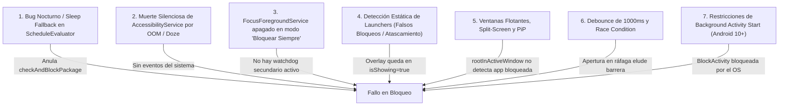

# 🔍 01. Diagnóstico de Causas Raíz: ¿Por qué la app a veces no bloquea?

Este documento desglosa minuciosamente el análisis forense realizado sobre el código fuente de **Enigma Focus**, identificando las razones exactas por las cuales las aplicaciones bloqueadas logran eludir el bloqueo o abrirse sin restricción.

---

## 🛑 Hallazgos Críticos y Puntos Ciegos Detectados



---

### 1. ⚠️ Bug Crítico en `ScheduleEvaluator` y Fallback Nocturno Forzado
* **Archivo afectado:** [`ScheduleEvaluator.kt`](file:///home/enigma/github/kotlin/enigma-focus-app/app/src/main/java/com/example/enigmafocus/core/scheduler/ScheduleEvaluator.kt#L21-L35) y [`FocusAccessibilityService.kt`](file:///home/enigma/github/kotlin/enigma-focus-app/app/src/main/java/com/example/enigmafocus/service/FocusAccessibilityService.kt#L228-L236)
* **El Problema:**
  En `ScheduleEvaluator.kt`:
  ```kotlin
  fun isSleepScheduleActive(calendar: Calendar = Calendar.getInstance()): Boolean {
      // ...
      // Fallback default: 22:30 to 06:30 overnight check
      val currentMinutes = calendar.get(Calendar.HOUR_OF_DAY) * 60 + calendar.get(Calendar.MINUTE)
      val isOvernight = currentMinutes >= (22 * 60 + 30) || currentMinutes < (6 * 60 + 30)
      return isOvernight
  }
  ```
  Y en `FocusAccessibilityService.kt`:
  ```kotlin
  if (ScheduleEvaluator.isSleepScheduleActive()) {
      checkSleepSchedule(packageName)
  } else {
      checkAndBlockPackage(packageName) // <--- ¡NUNCA SE EJECUTA SI ES DE NOCHE!
      val root = rootInActiveWindow
      if (root != null) {
          checkBrowserUrls(root, packageName)
      }
  }
  ```
* **Consecuencia:** 
  Todos los días entre las **22:30 y las 06:30** (o si el usuario tiene un intervalo de sueño activo), la app asume que está en "Modo Sueño". En dicho modo, **SÓLO** evalúa `checkSleepSchedule(packageName)`. Si el usuario descarta el aviso de sueño una sola vez, la app **DEJA DE BLOQUEAR TOTALMENTE** las aplicaciones seleccionadas de la lista negra (Instagram, TikTok, YouTube, etc.) y los dominios web.

---

### 2. 🪦 Muerte del `AccessibilityService` por el OOM Killer / Doze Mode
* **Archivo afectado:** [`FocusAccessibilityService.kt`](file:///home/enigma/github/kotlin/enigma-focus-app/app/src/main/java/com/example/enigmafocus/service/FocusAccessibilityService.kt#L41-L47)
* **El Problema:**
  En Android (especialmente en capas agresivas como Xiaomi MIUI/HyperOS, Samsung OneUI, ColorOS/OxygenOS), el sistema operativo mata los procesos de fondo para ahorrar batería cuando la pantalla se apaga o la memoria RAM escasea.
  Aunque `FocusAccessibilityService` es un servicio del sistema, Android puede desconectar o congelar el enlace IPC (Inter-Process Communication) del Accessibility Service.
* **Consecuencia:**
  El servicio deja de recibir eventos de accesibilidad (`onAccessibilityEvent`). Cuando el usuario enciende la pantalla y abre una app bloqueada, no ocurre absolutamente nada hasta que el usuario abre manualmente Enigma Focus.

---

### 3. 🛡️ Inexistencia del Servicio Centinela (`ForegroundService`) en "Bloquear Siempre"
* **Archivo afectado:** [`FocusForegroundService.kt`](file:///home/enigma/github/kotlin/enigma-focus-app/app/src/main/java/com/example/enigmafocus/service/FocusForegroundService.kt#L48-L64) y [`FocusSessionManager.kt`](file:///home/enigma/github/kotlin/enigma-focus-app/app/src/main/java/com/example/enigmafocus/manager/FocusSessionManager.kt#L33-L45)
* **El Problema:**
  `FocusForegroundService` (que cuenta con notificación persistente, watchdog cada 2 segundos y fallback por `UsageStatsManager`) **únicamente se inicia cuando el usuario presiona "Iniciar Sesión" (con temporizador)**.
  Si el usuario utiliza la función por defecto **"Bloquear siempre las apps seleccionadas"** (`always_block_selected_apps`), el Foreground Service **NO está en ejecución**.
* **Consecuencia:**
  En modo "Bloquear Siempre" (el modo más común de los usuarios), el proceso de Enigma Focus carece de prioridad de proceso en primer plano (`OOM_SCORE_ADJ`). Android lo considera un proceso prescindible en segundo plano y lo mata a los pocos minutos de apagar la pantalla.

---

### 4. 📱 Reconocimiento de Launchers Harcodeado y Desincronización de Overlays
* **Archivo afectado:** [`FocusInterceptor.kt`](file:///home/enigma/github/kotlin/enigma-focus-app/app/src/main/java/com/example/enigmafocus/core/interceptor/FocusInterceptor.kt#L49-L56) y [`BlockOverlayManager.kt`](file:///home/enigma/github/kotlin/enigma-focus-app/app/src/main/java/com/example/enigmafocus/ui/block/BlockOverlayManager.kt#L65-L69)
* **El Problema:**
  `FocusInterceptor.isLauncherPackage` utiliza una lista fija de strings:
  ```kotlin
  fun isLauncherPackage(packageName: String): Boolean {
      return packageName.contains("launcher") ||
             packageName == "com.miui.home" ||
             packageName == "com.sec.android.app.launcher" || ...
  }
  ```
  Existen múltiples launchers populares que no cumplen esta condición (por ejemplo: **Smart Launcher** `ginlemon.flowerfree`, launchers personalizados AOSP o de fabricantes menores como Motorola o Tecno).
  Además, en `BlockOverlayManager.kt`:
  ```kotlin
  if (isOverlayShowing) {
      return
  }
  ```
* **Consecuencia:**
  Si el launcher no es detectado, al regresar a la pantalla de inicio el overlay no se destruye de forma limpia o queda en un estado zombi (`isOverlayShowing = true`). Mientras esto ocurre, cualquier app bloqueada abierta posteriormente **ignora el bloqueo** debido al chequeo temprano.

---

### 5. 🪟 Limitación en Ventanas Múltiples (Split-Screen / Freeform / PiP)
* **Archivo afectado:** [`FocusAccessibilityService.kt`](file:///home/enigma/github/kotlin/enigma-focus-app/app/src/main/java/com/example/enigmafocus/service/FocusAccessibilityService.kt#L184-L186)
* **El Problema:**
  El servicio se apoya casi exclusivamente en `rootInActiveWindow`:
  ```kotlin
  val root = rootInActiveWindow
  val pkg = root?.packageName?.toString() ?: ""
  ```
* **Consecuencia:**
  Cuando el usuario ejecuta dos aplicaciones a la vez en pantalla dividida (Split-Screen) o abre la app de distracción en una ventana emergente flotante mientras tiene una app permitida activa, `rootInActiveWindow` devuelve la app que tiene el foco de accesibilidad primario. Si el foco no está en la ventana dividida bloqueada, la app no se intercepta.

---

### 6. ⏱️ Ventana de Vulnerabilidad en el Debounce de 1000ms
* **Archivo afectado:** [`FocusAccessibilityService.kt`](file:///home/enigma/github/kotlin/enigma-focus-app/app/src/main/java/com/example/enigmafocus/service/FocusAccessibilityService.kt#L311-L316)
* **El Problema:**
  ```kotlin
  val now = System.currentTimeMillis()
  if (packageName == lastBlockedPkg && (now - lastBlockedTime) < 1000) {
      return
  }
  lastBlockedPkg = packageName
  lastBlockedTime = now
  ```
* **Consecuencia:**
  Si el usuario pulsa rápidamente varias veces el icono de la app en su launcher o utiliza el gesto de volver hacia atrás inmediatamente al aparecer la pantalla de bloqueo, dentro de ese intervalo de 1000ms la app puede abrirse y permanecer en primer plano sin que se vuelva a disparar la pantalla de bloqueo.

---

### 7. 🚫 Restricciones de Inicio de Actividades en Segundo Plano (BAL - Android 10 a 14)
* **Archivo afectado:** [`FocusAccessibilityService.kt`](file:///home/enigma/github/kotlin/enigma-focus-app/app/src/main/java/com/example/enigmafocus/service/FocusAccessibilityService.kt#L322-L333) y [`FocusForegroundService.kt`](file:///home/enigma/github/kotlin/enigma-focus-app/app/src/main/java/com/example/enigmafocus/service/FocusForegroundService.kt#L190-L202)
* **El Problema:**
  A partir de Android 10, Google restringió severamente `startActivity()` desde Services en segundo plano (`Background Activity Launch restrictions`).
* **Consecuencia:**
  Si la app intenta invocar `startActivity(BlockActivity)` como mecanismo de respaldo desde un servicio que no está visible para el usuario, Android simplemente aborta el Intent con la advertencia en logcat: `Background activity start [BlockActivity] prohibited`. Si en ese momento el overlay de accesibilidad sufre algún retraso, la app bloqueada queda visible.
