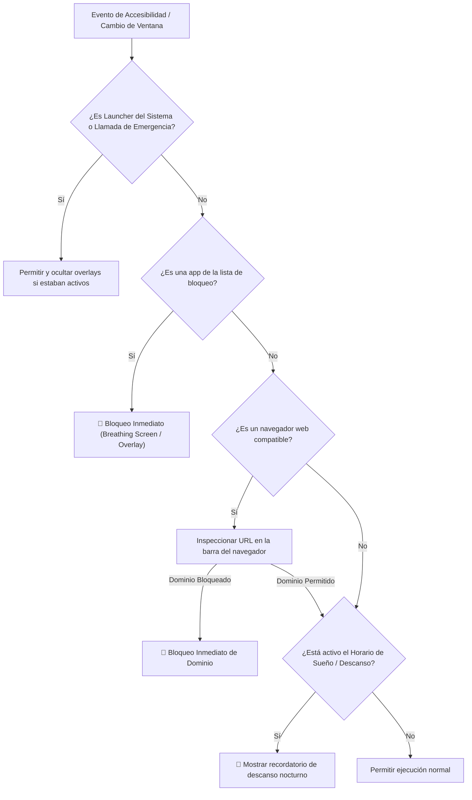

# 🛠️ 02. Reparación de Lógica de Evaluación, Horarios de Sueño y Launchers

Este documento detalla las soluciones de código exactas para corregir los fallos de flujo lógico que causan el bypass del bloqueo en horarios nocturnos, launchers personalizados y debounces.

---

## 1. Corrección de la Jerarquía de Bloqueo (Fin al Bypass Nocturno)

### El Fallo Actual
Actualmente, la comprobación en [`FocusAccessibilityService.kt`](file:///home/enigma/github/kotlin/enigma-focus-app/app/src/main/java/com/example/enigmafocus/service/FocusAccessibilityService.kt#L228-L236) tiene una bifurcación excluyente:
```kotlin
// CÓDIGO DEFECTUOSO ACTUAL:
if (ScheduleEvaluator.isSleepScheduleActive()) {
    checkSleepSchedule(packageName)
} else {
    checkAndBlockPackage(packageName)
    val root = rootInActiveWindow
    if (root != null) {
        checkBrowserUrls(root, packageName)
    }
}
```

### La Nueva Arquitectura Lógica
Las apps de distracción (Instagram, TikTok, YouTube, etc.) deben ser bloqueadas **SIEMPRE**, exista o no modo de descanso nocturno. El modo de descanso añade una capa superior sobre el resto del dispositivo (para invitar a dormir), pero **nunca debe levantar las restricciones de las apps adictivas**.



### Implementación Propuesta en `FocusAccessibilityService.kt`:
```kotlin
override fun onAccessibilityEvent(event: AccessibilityEvent?) {
    if (event == null) return
    recordHeartbeat()

    try {
        val pkgCharSequence = event.packageName ?: return
        val targetPackage = pkgCharSequence.toString()

        // 1. Omitir paquetes críticos del sistema
        if (targetPackage == packageName || 
            targetPackage == "android" || 
            targetPackage.contains("systemui") || 
            targetPackage.contains("inputmethod")) {
            return
        }

        // 2. Si el usuario vuelve a su launcher, esconder overlays activos inmediatamente
        if (isDynamicLauncher(targetPackage)) {
            if (BlockOverlayManager.isShowing()) {
                BlockOverlayManager.hideOverlay(this)
            }
            return
        }

        // 3. Regla de oro: Bloquear siempre apps de distracción configuradas
        if (FocusInterceptor.shouldBlockPackage(packageName, targetPackage)) {
            triggerBlockScreen(targetPackage)
            return
        }

        // 4. Si es un navegador, revisar si navega en una URL bloqueada
        if (FocusInterceptor.BROWSER_PACKAGES.contains(targetPackage)) {
            val root = rootInActiveWindow
            if (root != null) {
                checkBrowserUrls(root, targetPackage)
            }
            return
        }

        // 5. Sólo después de verificar la lista negra, evaluar aviso de sueño para apps neutrales
        if (ScheduleEvaluator.isSleepScheduleActive()) {
            checkSleepSchedule(targetPackage)
        }

    } catch (t: Throwable) {
        Log.e(TAG, "Unhandled exception in onAccessibilityEvent", t)
    }
}
```

---

## 2. Eliminación del Fallback Ciego en `ScheduleEvaluator.kt`

### Problema
En [`ScheduleEvaluator.kt`](file:///home/enigma/github/kotlin/enigma-focus-app/app/src/main/java/com/example/enigmafocus/core/scheduler/ScheduleEvaluator.kt#L31-L35), existía un fallback que forzaba el horario nocturno de 22:30 a 06:30 incluso si el usuario había borrado o desactivado el intervalo en la configuración.

### Solución
Respetar rigurosamente la configuración guardada por el usuario en `AppPreferences`:
```kotlin
fun isSleepScheduleActive(calendar: Calendar = Calendar.getInstance()): Boolean {
    // 1. Revisar los intervalos reales configurados por el usuario
    val activeInterval = AppPreferences.getActiveScheduledInterval(calendar)
    if (activeInterval != null && isSleepInterval(activeInterval)) {
        return true
    }

    // 2. Si el usuario tiene intervalos explícitos pero ninguno está activo ahora, no forzar nada
    val configuredIntervals = AppPreferences.getIntervals()
    if (configuredIntervals.isNotEmpty()) {
        return configuredIntervals.any { it.isEnabled && isSleepInterval(it) && it.isCurrentlyActive(calendar) }
    }

    // 3. Sólo si no hay ningún intervalo configurado en absoluto, evaluar si el usuario activó la opción predeterminada
    return false
}
```

---

## 3. Detección Dinámica e Infalible de Launchers

### Problema
Los launchers no pueden determinarse comparando si el nombre del paquete contiene la palabra `"launcher"`. Existen cientos de launchers (Smart Launcher `ginlemon.flowerfree`, Niagara, Nova, Hyperion, launchers de fabricantes OEM) cuyos nombres de paquete no contienen esa palabra.

### Solución: Consulta al `PackageManager` del Sistema Android
Android define oficialmente el Launcher del sistema mediante la acción `Intent.ACTION_MAIN` con categoría `Intent.CATEGORY_HOME`.

```kotlin
object LauncherDetector {
    private var cachedLauncherPackages: Set<String> = emptySet()
    private var lastQueryTime: Long = 0L
    private const val CACHE_EXPIRY_MS = 60_000L // Refrescar cada 1 minuto

    fun isHomeLauncher(context: Context, packageName: String): Boolean {
        if (packageName.isBlank()) return false

        val now = System.currentTimeMillis()
        if (cachedLauncherPackages.isEmpty() || (now - lastQueryTime) > CACHE_EXPIRY_MS) {
            updateHomeLaunchers(context)
            lastQueryTime = now
        }

        return cachedLauncherPackages.contains(packageName) ||
               packageName == "com.android.launcher3" ||
               packageName == "com.google.android.apps.nexuslauncher" ||
               packageName == "com.sec.android.app.launcher" ||
               packageName == "com.miui.home"
    }

    fun updateHomeLaunchers(context: Context) {
        try {
            val intent = Intent(Intent.ACTION_MAIN).apply {
                addCategory(Intent.CATEGORY_HOME)
            }
            val resolveInfos = context.packageManager.queryIntentActivities(
                intent,
                PackageManager.MATCH_DEFAULT_ONLY
            )
            val detected = resolveInfos.mapNotNull { it.activityInfo?.packageName }.toSet()
            if (detected.isNotEmpty()) {
                cachedLauncherPackages = detected
            }
        } catch (e: Exception) {
            Log.e("LauncherDetector", "Error querying home launchers", e)
        }
    }
}
```

---

## 4. Reestructuración del Debounce (Anti-Spam sin Fugas)

### Problema
El filtro actual:
```kotlin
if (packageName == lastBlockedPkg && (now - lastBlockedTime) < 1000) return
```
crea una ventana ciega de 1 segundo en la que una app bloqueada puede abrirse y permanecer en pantalla si el usuario presiona "atrás" y reabre la app rápidamente.

### Solución
El debounce sólo debe aplicar al **disparo sonoro/háptico (vibración)** y a la creación de nuevas instancias del Overlay, **pero el overlay visible y el bloqueo deben mantenerse firmes mientras la app bloqueada continúe en primer plano**:
```kotlin
if (BlockOverlayManager.isShowing()) {
    // Si ya estamos mostrando el bloqueo para esta app, no re-crear la vista,
    // pero ASEGURAR que permanece visible y bloqueando la interacción
    if (BlockOverlayManager.getCurrentPackage() == targetPackage) {
        return
    }
}
```
Además, si el overlay se oculta porque el usuario se fue al Home, `clearDebounce()` se invoca instantáneamente, permitiendo que si el usuario vuelve a presionar el icono 200ms después, el bloqueo se ejecute de nuevo en 0 milisegundos.
