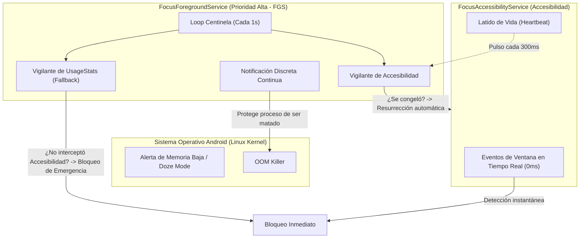

# 🛡️ 03. Servicio Guardián Persistente y Watchdog Bidireccional

Este documento describe la arquitectura para mantener a **Enigma Focus** con vida permanente en el sistema operativo, garantizando que el bloqueo funcione el 100% del tiempo incluso si el usuario no tiene una sesión de temporizador manual activa.

---

## 1. El Problema Actual: Proceso Huérfano en "Bloquear Siempre"

En la implementación actual:
- Si el usuario inicia una sesión de 25 minutos, `FocusForegroundService` se ejecuta con una notificación continua.
- Pero si el usuario utiliza **"Bloquear siempre las apps seleccionadas"** (que es la configuración más habitual de un bloqueador de productividad), **no existe ningún Foreground Service corriendo**.
- En consecuencia:
  1. El sistema Android asigna al proceso un puntaje de memoria `oom_adj` alto (proceso secundario en segundo plano).
  2. Cuando el móvil entra en reposo o el usuario abre un juego pesado, el kernel de Android mata el proceso de Enigma Focus.
  3. El enlace IPC de `FocusAccessibilityService` queda interrumpido hasta que el usuario reabre la app manualmente.

---

## 2. Nueva Arquitectura: Modo "Guardián Permanente" (Centinela)



---

## 3. Implementación del Modo Guardián en `FocusForegroundService`

### Estados del Servicio
El `FocusForegroundService` debe soportar dos modos de operación:
1. **Modo Sesión Activa (`MODE_TIMER_SESSION`):** Muestra el tiempo restante (ej. "Tiempo restante: 18:42") con botón para pausar/detener si no está en Modo Estricto.
2. **Modo Centinela Silencioso (`MODE_SENTINEL_SHIELD`):** Muestra una notificación minimalista y de baja prioridad (ej. "🛡️ Escudo de concentración activo") que otorga al proceso inmunidad frente al OOM Killer de Android.

### Notificación Persistente para Modo Centinela
```kotlin
private fun buildSentinelNotification(): Notification {
    val isEng = AppPreferences.isEnglish()
    val title = if (isEng) "🛡️ Enigma Focus Sentinel" else "🛡️ Escudo Enigma Focus"
    val content = if (isEng) "App blocking shield is active" else "Protección contra distracciones activa"

    val openAppIntent = Intent(this, MainActivity::class.java).apply {
        flags = Intent.FLAG_ACTIVITY_SINGLE_TOP
    }
    val pendingOpen = PendingIntent.getActivity(
        this, 0, openAppIntent,
        PendingIntent.FLAG_UPDATE_CURRENT or PendingIntent.FLAG_IMMUTABLE
    )

    return NotificationCompat.Builder(this, FocusApp.FOCUS_NOTIFICATION_CHANNEL_ID)
        .setSmallIcon(R.mipmap.ic_launcher)
        .setContentTitle(title)
        .setContentText(content)
        .setOngoing(true)
        .setOnlyAlertOnce(true)
        .setPriority(NotificationCompat.PRIORITY_MIN) // No molesta al usuario
        .setContentIntent(pendingOpen)
        .setForegroundServiceBehavior(NotificationCompat.FOREGROUND_SERVICE_IMMEDIATE)
        .build()
}
```

---

## 4. Activación Automática del Guardián

El servicio guardián debe iniciarse de forma transparente en los siguientes puntos clave:
1. **Al iniciar la aplicación (`FocusApp.onCreate`):** Si `isAlwaysBlockEnabled()` o hay horarios programados.
2. **Al reiniciar el dispositivo (`BootReceiver`):** Asegurar que arranque inmediatamente con `ACTION_BOOT_COMPLETED` y `ACTION_MY_PACKAGE_REPLACED`.
3. **Al activar la casilla "Bloquear siempre":** Iniciar el servicio sin esperar a que el usuario cree un temporizador.

```kotlin
object FocusSentinelManager {
    fun syncSentinelState(context: Context) {
        val shouldRun = AppPreferences.isFocusActive() || 
                        AppPreferences.isAlwaysBlockEnabled() || 
                        ScheduleEvaluator.isFocusActive()

        val intent = Intent(context, FocusForegroundService::class.java)
        if (shouldRun) {
            intent.action = if (AppPreferences.isFocusActive()) {
                FocusForegroundService.ACTION_START_TIMER
            } else {
                FocusForegroundService.ACTION_START_SENTINEL
            }
            if (Build.VERSION.SDK_INT >= Build.VERSION_CODES.O) {
                context.startForegroundService(intent)
            } else {
                context.startService(intent)
            }
        } else {
            intent.action = FocusForegroundService.ACTION_STOP
            context.startService(intent)
        }
    }
}
```

---

## 5. Resurrección Automática del Servicio de Accesibilidad

Si el servicio de accesibilidad llega a perder la conexión por una optimización de memoria extrema:
1. **Detección por pulso de vida:** El servicio de accesibilidad graba `lastHeartbeatTime` en cada evento o en su corrutina interna. Si transcurren más de 4000ms sin pulso mientras la pantalla está encendida, se considera en estado zombi.
2. **Reinicio mediante comando de sistema (Write Secure Settings):**
   Gracias a los permisos concedidos por Shizuku/ADB (`WRITE_SECURE_SETTINGS`), el guardián puede re-enlazar el componente de accesibilidad en segundo plano sin pedir interacción al usuario:
   ```kotlin
   FocusAccessibilityService.restartAccessibilityService(context)
   ```
3. **Notificación de alerta si los permisos fueron revocados:** Si el servicio detecta que el usuario apagó el permiso de accesibilidad en los ajustes de Android, emite una notificación de advertencia pulsable que lleva al usuario directo a la pantalla de accesibilidad para reactivarlo con un solo toque.
