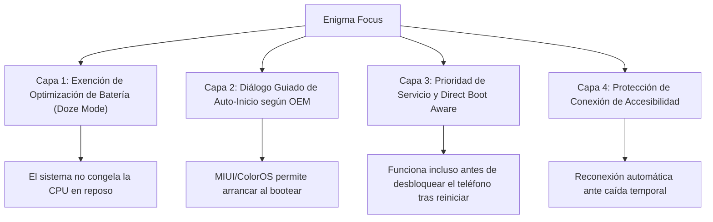

# 🔋 04. Blindaje Contra Asesinos de Procesos OEM y Doze Mode

Este documento aborda las políticas de ahorro de batería agresivas de los fabricantes de smartphones (Xiaomi, Samsung, Huawei, OnePlus, Oppo, Vivo, etc.) y cómo blindar a **Enigma Focus** para que nunca sea terminado en segundo plano.

---

## 1. El Problema de los Fabricantes (El fenómeno "Don't Kill My App")

Android puro (AOSP) respeta los servicios en primer plano (`Foreground Services`). Sin embargo, casi todos los fabricantes implementan capas personalizadas con asesinos de procesos despiadados:

| Fabricante | Sistema Operativo | Comportamiento Agresivo | Impacto en Enigma Focus |
| :--- | :--- | :--- | :--- |
| **Xiaomi / Poco / Redmi** | MIUI / HyperOS | Apaga Accessibility Services tras 10 min con pantalla apagada. Impide el autoinicio. | El bloqueo deja de responder por completo. |
| **Samsung** | One UI | Mueve apps a "Aplicaciones en suspensión profunda" si no se abren en 3 días. | Detiene el servicio y los receptores de arranque. |
| **Huawei / Honor** | EMUI / MagicOS | Limpia apps de memoria RAM agresivamente al bloquear pantalla. | Cierra el proceso centinela. |
| **Oppo / Realme / OnePlus** | ColorOS / OxygenOS | Mata procesos que no tienen activada la opción de "Inicio automático". | Bloquea el reinicio tras el arranque. |

---

## 2. Estrategia de Blindaje en 4 Capas



---

## 3. Implementación: Exención de Batería Nativa

Se debe implementar una verificación directa en la pantalla de Configuración (`SettingsScreen.kt`) y en el primer arranque:

```kotlin
object BatteryOptimizationHelper {

    fun isIgnoringBatteryOptimizations(context: Context): Boolean {
        val powerManager = context.getSystemService(Context.POWER_SERVICE) as? PowerManager ?: return false
        return powerManager.isIgnoringBatteryOptimizations(context.packageName)
    }

    fun requestIgnoreBatteryOptimizations(context: Context) {
        if (!isIgnoringBatteryOptimizations(context)) {
            try {
                val intent = Intent(Settings.ACTION_REQUEST_IGNORE_BATTERY_OPTIMIZATIONS).apply {
                    data = Uri.parse("package:${context.packageName}")
                    flags = Intent.FLAG_ACTIVITY_NEW_TASK
                }
                context.startActivity(intent)
            } catch (e: Exception) {
                // Fallback a los ajustes generales de batería si el OEM bloqueó el intent directo
                val fallbackIntent = Intent(Settings.ACTION_IGNORE_BATTERY_OPTIMIZATION_SETTINGS).apply {
                    flags = Intent.FLAG_ACTIVITY_NEW_TASK
                }
                context.startActivity(fallbackIntent)
            }
        }
    }
}
```

---

## 4. Detección Inteligente del Fabricante e Intents de Auto-Inicio

Para evitar que los usuarios sufran muertes silenciosas en Xiaomi o Samsung, creamos una utilidad que abre directamente la pantalla oculta de permisos de auto-arranque del fabricante:

```kotlin
object OemOptimizationHelper {

    fun getDeviceManufacturer(): String = Build.MANUFACTURER.lowercase()

    fun openAutoStartSettings(context: Context): Boolean {
        val manufacturer = getDeviceManufacturer()
        val intents = mutableListOf<Intent>()

        when {
            manufacturer.contains("xiaomi") || manufacturer.contains("redmi") || manufacturer.contains("poco") -> {
                intents.add(Intent().setComponent(ComponentName("com.miui.securitycenter", "com.miui.permcenter.autostart.AutoStartManagementActivity")))
            }
            manufacturer.contains("samsung") -> {
                intents.add(Intent().setComponent(ComponentName("com.samsung.android.lool", "com.samsung.android.sm.battery.ui.BatteryActivity")))
                intents.add(Intent().setComponent(ComponentName("com.samsung.android.sm", "com.samsung.android.sm.ui.battery.BatteryActivity")))
            }
            manufacturer.contains("huawei") || manufacturer.contains("honor") -> {
                intents.add(Intent().setComponent(ComponentName("com.huawei.systemmanager", "com.huawei.systemmanager.startupmgr.ui.StartupNormalAppListActivity")))
                intents.add(Intent().setComponent(ComponentName("com.huawei.systemmanager", "com.huawei.systemmanager.optimize.bootstart.BootStartActivity")))
            }
            manufacturer.contains("oppo") || manufacturer.contains("realme") -> {
                intents.add(Intent().setComponent(ComponentName("com.coloros.safecenter", "com.coloros.safecenter.permission.startup.StartupAppListActivity")))
            }
            manufacturer.contains("vivo") -> {
                intents.add(Intent().setComponent(ComponentName("com.iqoo.secure", "com.iqoo.secure.ui.phoneoptimize.AddWhiteListActivity")))
            }
            manufacturer.contains("oneplus") -> {
                intents.add(Intent().setComponent(ComponentName("com.oneplus.security", "com.oneplus.security.chainlaunch.view.ChainLaunchAppListActivity")))
            }
        }

        for (intent in intents) {
            try {
                intent.flags = Intent.FLAG_ACTIVITY_NEW_TASK
                context.startActivity(intent)
                return true
            } catch (e: Exception) {
                // Intentar el siguiente intent conocido para esta marca
            }
        }

        // Si fallan los intents específicos, abrir la pantalla de información de la app
        return try {
            val appInfoIntent = Intent(Settings.ACTION_APPLICATION_DETAILS_SETTINGS).apply {
                data = Uri.parse("package:${context.packageName}")
                flags = Intent.FLAG_ACTIVITY_NEW_TASK
            }
            context.startActivity(appInfoIntent)
            true
        } catch (e: Exception) {
            false
        }
    }
}
```

---

## 5. Soporte Direct Boot (`directBootAware`)

En [`AndroidManifest.xml`](file:///home/enigma/github/kotlin/enigma-focus-app/app/src/main/AndroidManifest.xml#L70), el `FocusAccessibilityService` ya está marcado como `android:directBootAware="true"`.
Para blindar el sistema al 100%:
1. `BootReceiver` también debe ser marcado con `android:directBootAware="true"`.
2. Las preferencias indispensables para el bloqueo (`blocked_packages`, `always_block_selected_apps`) deben almacenarse o sincronizarse en el **Contexto de Almacenamiento Protegido del Dispositivo** (`createDeviceProtectedStorageContext()`):
   ```kotlin
   val deviceContext = context.createDeviceProtectedStorageContext()
   val safePrefs = deviceContext.getSharedPreferences("enigma_focus_device_safe", Context.MODE_PRIVATE)
   ```
   Esto garantiza que si el teléfono se reinicia en el bolsillo del usuario, las apps bloqueadas **no se puedan abrir ni siquiera antes de que el usuario ingrese el PIN de arranque por primera vez**.
