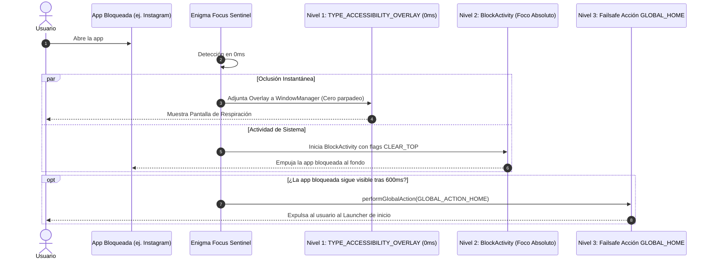

# 🧱 05. Mecanismos de Bloqueo Multinivel "Zero-Bypass"

Este documento define la arquitectura de intercepción y oclusión visual a prueba de evasiones, eliminando cualquier ventana de tiempo donde una aplicación bloqueada pueda mostrar contenido al usuario.

---

## 1. La Filosofía "Zero-Bypass" (Defensa en Profundidad)

Un único método de bloqueo (sólo Activity o sólo Overlay) siempre presenta fallas:
- **Si sólo se usa `startActivity(BlockActivity)`:** Android 10+ puede demorar 200–500ms en hacer la transición de ventanas, permitiendo que el usuario vea publicaciones o mensajes antes de que aparezca la pantalla de bloqueo, o puede rechazar la apertura desde segundo plano.
- **Si sólo se usa `WindowManager.addView(Overlay)`:** Si el servicio de accesibilidad sufre un retraso en la composición de Compose o si el usuario pulsa un botón de hardware de forma extraña, el overlay podría no atrapar el foco de entrada táctil.

Por ello, implementamos una **Defensa Escalonada en 3 Niveles Consecutivos**:



---

## 2. Nivel 1: `TYPE_ACCESSIBILITY_OVERLAY` de Latencia Cero

El overlay de accesibilidad es la herramienta más veloz de Android porque no requiere permiso de `SYSTEM_ALERT_WINDOW` y se renderiza directamente en el compositor de la ventana sin cambiar el ciclo de vida de la actividad actual:

```kotlin
val layoutParams = WindowManager.LayoutParams().apply {
    width = WindowManager.LayoutParams.MATCH_PARENT
    height = WindowManager.LayoutParams.MATCH_PARENT
    type = WindowManager.LayoutParams.TYPE_ACCESSIBILITY_OVERLAY
    flags = WindowManager.LayoutParams.FLAG_NOT_TOUCH_MODAL or
            WindowManager.LayoutParams.FLAG_LAYOUT_IN_SCREEN or
            WindowManager.LayoutParams.FLAG_FULLSCREEN or
            WindowManager.LayoutParams.FLAG_WATCH_OUTSIDE_TOUCH
    format = PixelFormat.TRANSLUCENT
    gravity = Gravity.CENTER
}
```

### Prevención de Fugas de Estado (`isShowing`)
Para evitar que un error o animación deje el flag `isShowing = true` para siempre:
1. **Doble verificación con `view.isAttachedToWindow`:** No confiar sólo en una variable booleana en memoria.
2. **Auto-recuperación ante cambios de ventana:** Si el servicio detecta un paquete no bloqueado (y que no sea SystemUI), llamar a `forceResetOverlayState()`.

```kotlin
fun isShowing(): Boolean {
    val view = overlayView
    return isOverlayShowing && view != null && view.isAttachedToWindow
}

fun forceResetOverlayState(context: Context) {
    if (isOverlayShowing || overlayView != null) {
        hideOverlay(context)
    }
}
```

---

## 3. Nivel 2: `BlockActivity` con Flags de Aislamiento Total

Para garantizar que la app bloqueada no continúe ejecutando procesos en primer plano (reproduciendo audio de reels o consumiendo datos):
1. La `BlockActivity` debe tener la prioridad más alta de visualización.
2. Debe configurarse en el `AndroidManifest.xml` con:
   - `android:launchMode="singleTask"`
   - `android:excludeFromRecents="true"`
   - `android:noHistory="true"`
   - `android:taskAffinity=""` (para que no se acople a la pila de tareas de la app bloqueada ni de Enigma Focus).

```kotlin
val blockIntent = Intent(context, BlockActivity::class.java).apply {
    putExtra(BlockActivity.EXTRA_BLOCKED_PACKAGE, packageName)
    flags = Intent.FLAG_ACTIVITY_NEW_TASK or
            Intent.FLAG_ACTIVITY_CLEAR_TOP or
            Intent.FLAG_ACTIVITY_NO_ANIMATION
}
context.startActivity(blockIntent)
```

---

## 4. Nivel 3: El Failsafe Definitivo (`GLOBAL_ACTION_HOME`)

Si por alguna razón extrema (dispositivo con memoria saturada, incompatibilidad de GPU con el ComposeView, o intento del usuario de burlar la app mediante gestos de navegación rápidos) la aplicación bloqueada sigue visible en `rootInActiveWindow` durante más de 2 ciclos del watchdog (~600ms):

```kotlin
// Failsafe de expulsión inmediata
if (FocusInterceptor.shouldBlockPackage(packageName, currentPackage) &&
    !isBlockScreenVisiblyOccluding()
) {
    failedOcclusionCounter++
    if (failedOcclusionCounter >= 2) {
        Log.w(TAG, "🚨 Failsafe extremo activado: Expulsando $currentPackage a HOME")
        performGlobalAction(GLOBAL_ACTION_HOME)
        failedOcclusionCounter = 0
    }
}
```

Este tercer nivel garantiza que, incluso en el peor escenario concebible, la distracción es expulsada del campo visual del usuario en menos de 1 segundo.
