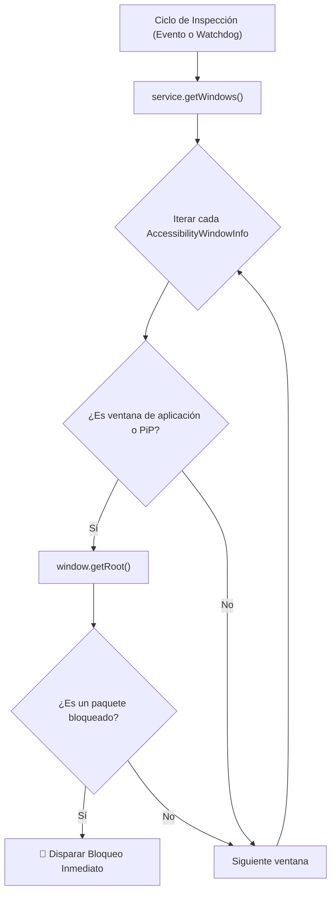

# 🪟 06. Detección Avanzada en Pantalla Dividida (Split-Screen), Modo PiP y Ventanas Flotantes

Este documento detalla la estrategia técnica para neutralizar los métodos de evasión mediante multitarea avanzada: pantalla dividida, ventanas flotantes (Samsung Pop-up, Xiaomi Freeform) y Picture-in-Picture (PiP).

---

## 1. El Problema de la Multitarea Moderna en Android

En versiones recientes de Android (10 a 14), los usuarios pueden abrir aplicaciones en modos que engañan a los métodos convencionales de detección:

1. **Pantalla Dividida (Split-Screen):** El usuario coloca arriba una app permitida (ej. Calculadora o Notas) y abajo una app bloqueada (ej. Instagram o YouTube). Si el foco táctil está en la app de arriba, `rootInActiveWindow` devuelve la app permitida, dejando la app bloqueada visible e interactiva.
2. **Ventanas Flotantes / Modo Libre (Freeform Pop-up):** Común en One UI de Samsung y MIUI de Xiaomi. La app se abre como una ventana pequeña encima de otra.
3. **Picture-in-Picture (PiP):** La app bloqueada (ej. YouTube, Twitch) continúa reproduciendo video en miniatura mientras el usuario navega en otra app.

---

## 2. Solución: Inspección Exhaustiva con `AccessibilityService.getWindows()`

En lugar de inspeccionar únicamente `rootInActiveWindow`, el servicio debe aprovechar el flag `AccessibilityServiceInfo.FLAG_RETRIEVE_INTERACTIVE_WINDOWS` (ya declarado en la configuración del servicio) e iterar sobre la lista de ventanas interactivas del sistema.



---

## 3. Código de Implementación para Detección Multi-Ventana

```kotlin
object MultiWindowDetector {

    private const val TAG = "MultiWindowDetector"

    fun findBlockedPackageInAllWindows(
        service: AccessibilityService,
        ownPackage: String
    ): String? {
        try {
            val windows = service.windows
            if (windows.isNullOrEmpty()) {
                // Fallback a rootInActiveWindow si la lista de ventanas no está disponible
                val fallbackRoot = service.rootInActiveWindow
                val fallbackPkg = fallbackRoot?.packageName?.toString()
                return if (fallbackPkg != null && FocusInterceptor.shouldBlockPackage(ownPackage, fallbackPkg)) {
                    fallbackPkg
                } else null
            }

            for (window in windows) {
                // Inspeccionar ventanas de tipo aplicación y Picture-in-Picture
                if (window.type == AccessibilityWindowInfo.TYPE_APPLICATION || 
                    window.type == AccessibilityWindowInfo.TYPE_SPLIT_SCREEN_DIVIDER ||
                    (Build.VERSION.SDK_INT >= Build.VERSION_CODES.O && window.isInPictureInPictureMode)) {
                    
                    val root = window.root ?: continue
                    val pkg = root.packageName?.toString() ?: continue

                    if (FocusInterceptor.shouldBlockPackage(ownPackage, pkg)) {
                        Log.w(TAG, "🎯 Detectada app bloqueada ($pkg) en ventana tipo=${window.type}, pip=${if (Build.VERSION.SDK_INT >= Build.VERSION_CODES.O) window.isInPictureInPictureMode else false}")
                        return pkg
                    }
                }
            }
        } catch (e: Exception) {
            Log.e(TAG, "Error enumerating accessibility windows", e)
        }
        return null
    }
}
```

---

## 4. Tratamiento del Modo Picture-in-Picture (PiP)

Si una aplicación bloqueada intenta escapar hacia un mini-reproductor PiP:
1. Al detectarse en `MultiWindowDetector.findBlockedPackageInAllWindows()`, el servicio ejecuta una acción para cerrar el PiP o devolver al usuario al inicio:
```kotlin
if (window.isInPictureInPictureMode && FocusInterceptor.shouldBlockPackage(ownPackage, pkg)) {
    // Si la app intentó quedarse en PiP de fondo, forzamos regreso a Home para cerrarla
    service.performGlobalAction(AccessibilityService.GLOBAL_ACTION_HOME)
    BlockOverlayManager.showOverlay(service, pkg) {}
}
```
2. Esto asegura que vídeos o transmisiones en directo bloqueadas no puedan consumirse en segundo plano como audio o mini-pantalla.
