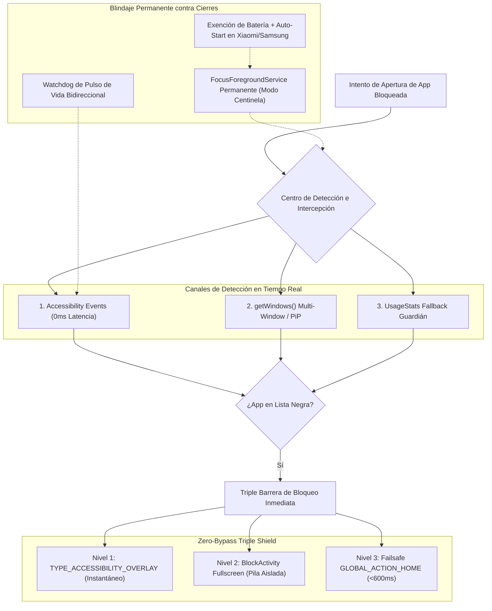
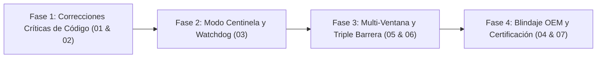

# 🛡️ Plan Integral de Mejora: Confiabilidad Absoluta y Bloqueo Infalible ("Zero-Bypass")

> **Diagnóstico del problema reportado:** *"A veces la app no impide o bloquea apps".*  
> Este plan técnico y arquitectónico detalla las causas raíz identificadas en el código fuente de **Enigma Focus** y presenta la hoja de ruta completa para transformar el sistema de bloqueo en una solución 100% robusta, inmune a cierres del sistema operativo y evasiones del usuario.

---

## 🗺️ Visión General de la Arquitectura de Bloqueo Robusto

---

## 📋 Estructura Detallada del Plan

Los documentos de este directorio abordan cada aspecto técnico de forma especializada:

| Documento | Enfoque | Resumen del Contenido |
| :--- | :--- | :--- |
| **[`01_diagnostico_causas_falla.md`](01_diagnostico_causas_falla.md)** | 🔍 **Diagnóstico Forense** | Identificación de los 7 puntos de fallo en el código actual: bug de horario nocturno, muerte por OOM, falta de Foreground Service en "Bloquear Siempre", debounces y launchers. |
| **[`02_reparacion_logica_evaluacion_y_sleep.md`](02_reparacion_logica_evaluacion_y_sleep.md)** | 🛠️ **Lógica y Horarios** | Reparación de la jerarquía de evaluación para que el horario de sueño no desactive el bloqueo de apps; detección dinámica de cualquier Launcher vía `PackageManager`. |
| **[`03_servicio_guardian_persistente_watchdog.md`](03_servicio_guardian_persistente_watchdog.md)** | 🛡️ **Servicio Centinela** | Creación del `FocusForegroundService` permanente en modo silencioso y watchdog bidireccional que revive automáticamente el servicio de accesibilidad. |
| **[`04_blindaje_contra_kill_y_oem_doze.md`](04_blindaje_contra_kill_y_oem_doze.md)** | 🔋 **Blindaje OEM y Batería** | Estrategia contra los asesinos de procesos de Xiaomi (MIUI/HyperOS), Samsung (One UI) y Huawei. Solicitud directa de exención de optimización de batería y autoinicio. |
| **[`05_mecanismos_bloqueo_multinivel_zero_bypass.md`](05_mecanismos_bloqueo_multinivel_zero_bypass.md)** | 🧱 **Defensa en Profundidad** | Triple barrera (Overlay de Accesibilidad + Actividad con flags aislados + Acción Home de emergencia). Corrección de fugas en `isShowing = true`. |
| **[`06_deteccion_avanzada_splitscreen_pip_flotantes.md`](06_deteccion_avanzada_splitscreen_pip_flotantes.md)** | 🪟 **Multitarea y PiP** | Cierre de brechas de evasión usando `AccessibilityService.getWindows()` para atrapar apps bloqueadas en pantalla dividida, ventanas emergentes flotantes y Picture-in-Picture. |
| **[`07_bateria_performance_y_plan_pruebas.md`](07_bateria_performance_y_plan_pruebas.md)** | 🧪 **Pruebas y Rendimiento** | Mantenimiento de consumo de batería por debajo del 1% diario, suspensión de vigilancia con pantalla apagada y matriz de 9 pruebas de calidad con comandos ADB. |

---

## 🚀 Fases de Ejecución Recomendadas

1. **Fase 1 (Inmediata / Quick Wins):**
   - Corregir el bug en [`FocusAccessibilityService.kt`](file:///home/enigma/github/kotlin/enigma-focus-app/app/src/main/java/com/example/enigmafocus/service/FocusAccessibilityService.kt) donde `isSleepScheduleActive()` anulaba la ejecución de `checkAndBlockPackage()`.
   - Eliminar el fallback nocturno forzado en [`ScheduleEvaluator.kt`](file:///home/enigma/github/kotlin/enigma-focus-app/app/src/main/java/com/example/enigmafocus/core/scheduler/ScheduleEvaluator.kt).
   - Sustituir la lista estática de nombres de launchers por la consulta dinámica al `PackageManager`.

2. **Fase 2 (Estabilidad de Proceso):**
   - Habilitar `FocusForegroundService` de forma continua cuando "Bloquear Siempre" esté activado.
   - Activar el auto-reinicio tras caída con `START_STICKY` y monitor de latido (`heartbeat`).

3. **Fase 3 (Anti-Evasión Avanzada):**
   - Incorporar la iteración sobre `service.windows` para detectar ventanas flotantes, Split-Screen y PiP.
   - Reforzar el Failsafe Nivel 3 (Acción Home inmediata ante persistencia no autorizada).

4. **Fase 4 (Blindaje de Sistema y Batería):**
   - Añadir la tarjeta de configuración guiada en la UI para solicitar exención de batería (`REQUEST_IGNORE_BATTERY_OPTIMIZATIONS`) y auto-inicio en capas OEM.
   - Validar la matriz de pruebas automatizadas con ADB.
